# 入门案例

JavaScript 是一种脚本语言，可以用来更改页面内容，控制多媒体，制作图像、动画等等

例子

* 修改页面内容

在浏览器控制台运行 JS 代码可以更改当前页面的内容，例如：

```html
<!DOCTYPE html>
<html lang="zh">
<head>
    <meta charset="UTF-8">
    <meta http-equiv="X-UA-Compatible" content="IE=edge">
    <meta name="viewport" content="width=device-width, initial-scale=1.0">
    <title>JS入门</title>
</head>
<body>
    <p id="p1">11111</p>
</body>
</html>
```

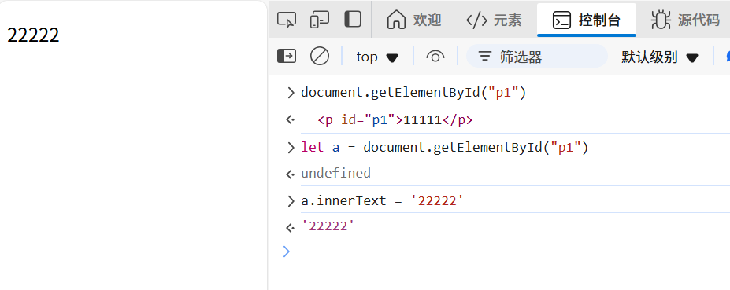

JS 代码的位置：

```html
<script>
	// JS代码
</script>
```

引入 JS 脚本：

```html
<script src="JS脚本路径"></script>
```

* 注意，到了框架之后，引入方式会有不同

# 一、变量与数据类型

## 1、声明变量

### 1.1、let

```js
let 变量名 = 值;
```

let 声明的变量可以被多次赋值，例如

```js
let a = 100;  // 初始值是 100
a = 200;	  // ok, 被重新赋值为 200
```

### 1.2、const

const 修饰的叫常量，只能赋值一次

```js
const b = 300; // 初始值是 300
b = 400;	   // error, 不能再次赋值
```

但 const 并不意味着它引用的内容不可修改，例如

```js
const c = [1, 2, 3];
c[2] = 4; 	  // ok, 数组内容被修改成 [1,2,4]
c = [5,6];    // error, 不能再次赋值
```

### 1.3、var

var 声明的变量可以被多次赋值，例如

```js
var f = 100;
f = 200;
```

> 能用 let 的话就不要用 var，因为 var 很容易出现作用域的问题

## 2、基本类型

### 2.1、undefined 和 null

* 执行表达式或函数，没有返回结果，出现 undefined
* 访问数组不存在的元素，访问对象不存在的属性，出现 undefined
* 定义变量，没有初始化，出现 undefined

代码示例：

```js
console.log(1);  	// 函数没有返回值, 结果是undefined

let a = 10;		 	// 表达式没有返回值, 结果是undefined

let b = [1,2,3];
console.log(b[10]); // 数组未定义元素是undefined

let c = {"name": "张三"};
console.log(c.age); // 对象未定义属性是undefined

let d;
console.log(d);		// 变量未初始化是undefined
// console.log(d.length); // 报错

let i = null;
console.log(i);
// console.log(i.length) // 报错
```

> undefined 和 null 二者共同点：
>
> * 都没有属性、方法
>
> 二者区别：
>
> * undefined 由 JavaScript 产生
> * null 由程序员提供
>
> 二者合称 Nullish

### 2.2、string

JS 字符串三种写法

```js
let a = "hello";  // 双引号
let b = "world";  // 单引号
let c = `hello`;  // 反引号
```

如下的 HTML 代码，用 Java 和 JS 中的字符串如何表示？

```html
<a href="1.html">超链接</a>
```

Java 显得比较繁琐

```java
String s1 = "<a href=\"1.html\">超链接</a>";

String s2 = """
    <a href="1.html">超链接</a>""";
```

JS 就比较灵活

```js
let s1 = '<a href="1.html">超链接</a>';

let s2 = `<a href="1.html">超链接</a>`;
```

JavaScript 还支持一种叫 模板字符串（Template strings）的语法，让字符串拼接看起来可读性更好

需求：拼接 URI 的请求参数，如

```
/test?name=zhang&age=18
/test?name=li&age=20
```

传统方法拼接

```js
let name = ; // zhang li ...
let age = ; // 18 20 ...

let uri = "/test?name=" + name + "&age=" + age;
```

模板字符串方式

```js
let name = ; // zhang li ...
let age = ; // 18 20 ...

let uri = `/test?name=${name}&age=${age}`;
```

> 注意模板字符串必须要用反引号的方式

### 2.3、number 和 bigint

number 类型标识的是双精度浮动小数，例如：

```js
10 / 3;   // 结果 3.3333333333333335
```

既然是浮点小数，那么可以除零

```js
10 / 0;	  // 结果 Infinity 正无穷大
-10 / 0;  // 结果 -Infinity 负无穷大
```

浮点小数都有运算精度问题，例如：

```js
2.0 - 1.1; // 结果 0.8999999999999999
```

字符串转数字：

```js
parseInt("10"); 	// 结果是数字 10 
parseInt("10.5");	// 结果是数字 10, 去除了小数部分
parseInt("10") / 3; // 结果仍视为 number 浮点数, 因此结果为 3.3333333333333335

parseInt("abc");	// 转换失败，结果是特殊值NaN (Not a Number)
```

还有种更简单的方式：用字符串减 0，因为 JS 发现减法两边的数据类型不一致的话，会尝试由 JS 进行类型转换，自动把字符串转换成 number，并且减 0 也不影响最终的值

但要注意加 0 操作会被 JS 识别为字符串拼接

```javascript
let num5 = '10' - 0
console.log(num5) // 10
console.log(typeof num5) // number

let num6 = '10' + 0
console.log(num6) // 100
console.log(typeof num6) // string
```

要表示真正的整数，需要用 bigint，数字的结尾用 n 表示它是一个 bigint 类型

```js
10n / 3n;    // 结果 3n, 按整数除法处理，注意整数除法不能除以0
```

### 2.4、boolean

* Truthy
* Falsy

在 JS 中，并不是 boolean 才能用于条件判断，你可以在 if 语句中使用【数字】、【字符串】... 作为判断条件

```js
let b = 1;

if (b) { // true
    console.log("进入了");
}
```

这时就有一个规则，当需要条件判断时，看这个值被当作 true 还是 false，当作 true 的值归类为 truthy，当作 false 的值归类为 falsy

下面值都是 falsy

* `false`
* `Nullish (null, undefined)`
* `0, 0n, NaN`
* ``` "" 或 '' 或 `` ```  即长度为零的字符串

剩余的值绝大部分都是 truthy

有几个容易被当作 falsy 实际是 truthy 的

* `"false", "0"` 即字符串的 false 和 字符串的零
* `[]` 空数组
* `{}` 空对象

### 2.5、symbol

* 很少使用

## 3、对象类型

### 3.1、Function

#### 定义函数

定义函数的语法：

```js
function 函数名(参数) {
    // 函数体
    return 结果
}
```

代码示例：

```js
function add(a, b) {
    return a + b
}
```

#### 调用函数

语法：

```js
函数名(实参);
```

例如：

```js
add(1, 2); // 返回 3
```

JS 中的函数调用特点：对参数的**类型**和**个数**都没有限制，例如

```js
add('a', 'b');  // 返回 ab
add(4, 5, 6);   // 返回 9, 第三个参数没有被用到, 不会报错
add(1);			// 返回 NaN, 这时 b 没有定义是 undefined, undefined 做数学运算结果就是 NaN
```

#### 默认参数

Java 中（Spring）要实现默认参数的效果得这么做：

```java
@RestController 
public class MyController {
    @RequestMapping("/page")
    @ResponseBody
    public void page(@RequestParam(defaultValue="1") int page, @RequestParam(defaultValue="10") int size) {
        // ...
    }
}
```

JS 中就简单得多：

```js
function pagination(page = 1, size = 10) {
    console.log(page, size);
}

pagination(2, 5)
pagination(2)
pagination(undefined, 5)
pagination()
```

#### 匿名函数

语法（建议在匿名函数两边加上括号）：

```js
(function (参数) {
    // 函数体
    return 结果;
})
```

代码示例：

```js
(function (a, b) {
    return a + b;
})
```

使用场景一：定义完毕后立刻调用

```js
(function (a, b) {
    return a + b;
})(1, 2)
```

使用场景二：作为其它对象的方法，例如

页面有元素

```html
<p id="p1">点我啊</p>
```

此元素有一个 onclick 方法，会在鼠标单击这个元素后被执行，onclick 方法刚开始是 null，需要赋值后才能使用

```js
document.getElementById("p1").onclick = (function () {
    console.log("鼠标单击了...");
});
```

#### 箭头函数

```js
(参数) => {
    // 函数体
    return 结果;
}
```

* 如果没有参数，`()` 还是要保留
* 如果只有一个参数，`()` 可以省略
* 如果函数体内只有一行代码，`{}` 可以省略
* 如果这一行代码就是结果，return 可以省略

代码示例：

```js
document.getElementById('p2').onclick = () => {
    console.log('clicked2...')
}

document.getElementById('p3').onclick = () => console.log('clicked3...')
```

#### 函数是对象

> JS 中函数的本质是一个对象

以下形式在 JS 中非常常见！

1. 函数对象可以参与赋值，例如具名函数也能参与赋值

```js
function abc() {
    console.log("bb");
}

document.getElementById("p1").onclick = abc;
```

2. 函数对象有属性、有方法，执行 `console.dir(abc)`，输出结果如下

```
ƒ abc()
    arguments: null
    caller: null
    length: 0
    name: "abc"
    ➡prototype: {constructor: ƒ}
    [[FunctionLocation]]: VM1962:1
    ➡[[Prototype]]: ƒ ()
    ➡[[Scopes]]: Scopes[1]
```

* 其中带有 f 标记的是方法，不带的是属性
* 带有 ➡ 符号的可以继续展开，限于篇幅省略了

* 带有 `[[ ]]` 的是内置属性，不能访问，只能查看
* 相对重要的是 `[[Prototype]]` 原型和 `[[Scopes]]` 作用域会在后面继承和作用域时讲到

3. 函数可以作为方法参数

```js
function a() {
    console.log('a')
}

function b(fn) {          // fn 将来可以是一个函数对象
    console.log('b')
    fn();                 // 调用函数对象
}

b(a)
```

4. 函数可以作为方法返回值

```js
function c() {
    console.log("c");
    function d() {
        console.log("d");
    }
    return d;
}

c() // c
console.log(c()) // ƒ d() { console.log('d') }
c()() // d
```

> b 函数接收了函数作为参数，c 函数的返回值是一个函数，b 函数和 c 函数都可以被称为高阶函数

#### 函数作用域

函数可以嵌套（JS 代码中很常见，只是嵌套的形式更多是匿名函数，箭头函数）

```js
function a() {
    function b() {        
    }
}
```

看下面的例子

```js
function c() {
    var z = 30;
}

var x = 10;
function a() {
    var y = 20;
    function b() {
        // 看这里
        console.log(x, y);
        // console.log(z) // error
    }
    console.dir(b)
    b();
    
    console.log(x)
    // console.log(z) // error
}
a();

// console.log(z) // error
```

* 以函数为分界线划定作用域，所有函数之外是全局作用域
* 查找变量时，由内向外查找
  * 在内层作用域找到变量，就会停止查找，不会再找外层
  * 所有作用域都找不到变量，报错
* 作用域本质上是函数对象的属性，可以通过 `console.dir` 来查看调试

#### 闭包

```js
var x = 10;
function a() {
    var y = 20;
    function b() {
        console.log(x, y);
    }
    return b;
}
a()();  // 在外面执行了b
```

函数定义时，它的作用域已经确定好了，因此无论函数将来去了哪，都能从它的作用域中找到当时那些变量

别被概念忽悠了，闭包就是指**函数能够访问自己的作用域中变量**

Java 中没有闭包的概念，但有类似的 Lambda 的参数捕获

```java
public class TestClosure {
    public static void main(String[] args) {
        a().accept(10); // 10,20
    }

    private static Consumer<Integer> a() {
        int y = 20;
        Consumer<Integer> b = x -> System.out.println(x + "," + y);
        return b;
    }
}
```

#### let、var 与作用域

如果函数外层引用的是 let 变量，那么外层普通的 {} 也会作为作用域边界，最外层的 let 也占一个 script 作用域

```js
let x = 10; 
if (true) {
    let y = 20;
    function b() {
        console.log(x, y);
    }
    console.dir(b); // 三层作用域
}
```

如果函数外层引用的是 var 变量，外层普通的 {} 不会视为边界

```js
var x = 10; 
if (true) {
    var y = 20;
    function b() {
        console.log(x, y);
    }
    console.dir(b); // 一层作用域
}
```

如果 var 变量出现了重名，且他俩处于同一作用域中，则他俩会被视为同一个变量

第一个 e 被视为变量的定义，第二个 e 被视为变量的赋值

```js
var e = 10;
if (true) {
    var e = 20;
    console.log(e);	// 打印 20
}
console.log(e);		// 因为是同一个变量，还是打印 20
```

如果是 let，则视为两个作用域中的两个变量

```js
let e = 10; 
if (true) {
    let e = 20;	
    console.log(e);	// 打印 20
}
console.log(e);		// 打印 10
```

要想里面的 e 和外面的 e 能区分开来，最简单的办法是改成 let，或者用函数来界定作用域范围

```js
var e = 10;
if (true) {
    function b() {
        var e = 20;
    	console.log(e);
    }
    b();
}
console.log(e);
```

### 3.2、Array

1、语法

```js
// 创建数组
let arr = [1,2,3]; 

// 获取数组元素
console.log(arr[0]); // 输出 1

// 修改数组元素
array[0] = 5;		 // 数组元素变成了 [5, 2, 3]

// 遍历数组元素，其中 length 是数组属性，代表数组长度
for(let i = 0; i < arr.length; i++) {
    console.log(arr[i]);
}
```

2、数组的常用 API：

（1）push、shift、splice

```js
let arr = [1, 2, 3]; 

arr.push(4);    	// 向数组尾部(右侧)添加元素, 结果 [1, 2, 3, 4]
arr.shift();		// 从数组头部(左侧)移除元素, 结果 [2, 3, 4]
arr.splice(1, 1);	// 从【参数1】索引位置往后删除【参数2】个元素，结果 [2, 4]
```

（2）join

```js
let arr = ['a','b','c'];

arr.join();       // 默认使用【,】作为连接符，结果 'a,b,c'
arr.join('');     // 结果 'abc'
arr.join('-');    // 结果 'a-b-c'
```

（3）map

* 传给 map 的函数，参数代表旧元素，返回值代表新元素

```js
let arr = [1,2,3,6];

function a(i) {   // 代表的新旧元素之间的变换规则
    return i * 10
}

// arr.map(a) // 具名函数，结果 [10, 20, 30, 60]

// arr.map((i) => {return i * 10} ); // 箭头函数
arr.map(i => i * 10); // 箭头函数
```

* map 的内部实现（伪代码）

```js
function map(a) { // 参数是一个函数
    let narr = [];
    for (let i = 0; i < arr.length; i++) {
        let o = arr[i]; // 旧元素
        let n = a(o);   // 新元素
        narr.push(n);
    }
    return narr;
}
```

（4）filter

* 传给 filter 的函数，参数代表旧元素，返回 true 表示要留下的元素

```js
let arr = [1, 2, 3, 6];
arr.filter(i => i % 2 == 1); // 结果 [1, 3]
```

（5）forEach

```js
let arr = [1,2,3,6];

for (let i = 0; i < arr.length; i++) {
    console.log(arr[i]);
}

arr.forEach(i => console.log(i));
```

> map 和 filter 并不会改变旧数组的内容，但 forEach 会改变原数组的内容

两个称呼：

* 高阶函数：接受了另一个函数作为参数，map、filter、forEach 都是高阶函数
* 回调函数，例如作为参数传入的函数

### 3.3、Object

#### 语法

```js
let obj = {
    属性名: 值,
    方法名: 函数,
    get 属性名() {},
    set 属性名(新值) {}
}
```

例 1

```js
let stu1 = {
    name: "小明",
    age: 18,
    study: function() {
        console.log(this.name + "爱学习");
    }
}

console.log(stu1.name)
console.log(stu1.age)
stu1.study()
```

例 2

```js
let name = "小黑";
let age = 20;
let study = function() {
    console.log(this.name + "爱学习");
}

let stu2 = {name, age, study}
console.log(stu2.name)
console.log(stu2.age)
stu2.study()
```

例 3（重点，用的最多）

```js
let stu3 = {
    name: "小白",
    age: 18,
    study() {
        console.log(this.name + "爱学习");
    }
}

console.log(stu3.name)
console.log(stu3.age)
stu3.study()
```

* **注意**：对象方法这么写，仅限于对象内部

例 4

```js
let stu4 = {
    _name: null, // 类似于Java中私有成员变量
    get name() { // 读取属性
        console.log("进入了get");
        return this._name;
    },
    
    set name(name) { // 设置属性
        console.log("进入了set");
        this._name = name;
    }
}
```

调用 get，set

```js
stu4.name = "小白" // 输出：进入了set

console.log(stu4.name) // 输出：进入了get，小白

console.log(stu4._name) // 小白
stu4._name = "zhangsan"
console.log(stu4._name)
```

_name 只是类似于 Java 中的私有成员变量，但其实还是可以访问到

JavaScript 中并没有私有的概念，只是约定前面加了下划线的不要直接访问

#### 特色：属性增删

对比一下 Java 中的 Object

* Java 的 Object 是以类作为模板来创建，对象不能脱离类模板的范围，一个对象的属性、能用的方法都是确定好的
* JS 的对象，不需要什么模板，它的属性和方法可以随时加减

```js
let stu = {name: '张三'};
stu.age = 18; // 添加属性
console.log(stu) // {name: '张三', age: 22}

delete stu.age;	// 删除属性
console.log(stu) // {name: '张三'}

stu.study = function() { // 添加方法
    console.log(this.name + "在学习");
}
stu.study() // 张三在学习
```

也可以添加 get、set 方法，但需要借助 `Object.definePropery` 方法

* 参数 1：目标对象
* 参数 2：属性名
* 参数 3：get、set 的定义

```js
let stu = {_name: null};

Object.defineProperty(stu, "name", {
    get() {
        return this._name;
    },
    
    set(name) {
        this._name = name;
    }
});

stu.name = '李四'
console.log(stu.name)
```

#### 特色：this

1、先来对 Java 中的 this 有个理解

```java
public class TestMethod {
    static class Student {
        private String name;

        public Student(String name) {
            this.name = name;
        }

        public void study(Student this, String subject) {
            System.out.println(this.name + "在学习 " + subject);
        }
        
        public void study1(String subject) {
            System.out.println(this.name + " 在学习 " + subject);
        }
    }

    public static void main(String[] args) {
        Student stu = new Student("小明");
        
        // 下面的代码，本质上是执行 study(stu, "Java")，因此 this 就是 stu
        stu.study("Java");
    }
}
```

* Java 中的 this 是个隐式参数，非静态方法都有隐式参数 this
* Java 中，我们说 this 代表的就是调用方法的那个对象

2、JS 中的 this 也是隐式参数，但它与函数运行时上下文相关

例如，一个 “落单” 的函数

```js
function study(subject) {
    console.log(this.name + "在学习 " + subject)
}
```

测试一下

```js
study("JS");  // 输出：在学习 JS
```

这是因为此时函数执行，全局对象 window 被当作了 this，而 window 对象的 name 属性是空串

```js
window.name = '我是window'
study1("JavaScript") // 我是window在学习 JavaScript
```

同样的函数，如果作为对象的方法

```js
let stu = {
    name: "小白",
    study
}
```

这种情况下，会将当前对象作为 this

```js
stu.study('JS'); // 输出：小白在学习 JS
```

还可以动态改变 this

```js
let stu = {name: "小黑"};
study.call(stu, "JS");	// 输出 小黑在学习 JS
```

这回 study 执行时，就把 call 的第一个参数 stu 作为 this

一个例外是，在**箭头函数**内出现的 this，以外层 this 理解 

用匿名函数

```js
let stu = {
    name: "小花",
    friends: ["小白", "小黑", "小明"],
    play() {
        this.friends.forEach(function(e) {
            console.log(this.name + "与" + e + "在玩耍");
        });
    }
}
stu.play()
```

* `this.name` 所在的函数是【落单】的函数，因此 this 代表 window

输出结果为：

```
与小白在玩耍
与小黑在玩耍
与小明在玩耍
```

若用箭头函数：

```js
let stu = {
    name: "小花",
    friends: ["小白", "小黑", "小明"],
    play() {
        this.friends.forEach(e => {
            console.log(this.name + "与" + e + "在玩耍");
        })
    }
}
stu10.play()
```

* this.name 所在的函数是箭头函数，因此 this 要看它外层的 play 函数，play 又是属于 stu 的方法，因此 this 代表 stu 对象

输出结果为：

```
小花与小白在玩耍
小花与小黑在玩耍
小花与小明在玩耍
```

还有种不用箭头函数也能实现与用箭头函数相同效果的做法：

```js
let stu = {
    name: "小花",
    friends: ["小白", "小黑", "小明"],
    play() {
        let me = this;
        this.friends.forEach(function(e) {
            console.log(me.name + "与" + e + "在玩耍");
        });
    }
}
```

#### 特色：原型继承

Java 中的继承：

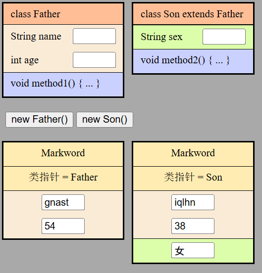

JavaScript 中的原型继承：

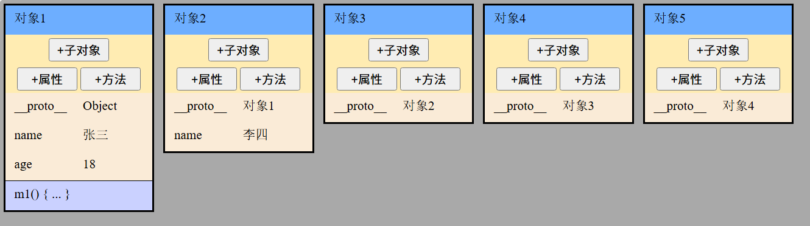

```js
let father = {
    f1: '父属性',
    m1: function() {
        console.log("父方法");
    }
}

let son = Object.create(father);
console.log(son.f1); // 输出：父属性

son.f2 = '子属性'
console.log(son.f2) // 输出：子属性
son.f1 = '子属性'
console.log(son.f1) // 输出：子属性

son.m1(); // 输出：父方法
console.dir(son)
```

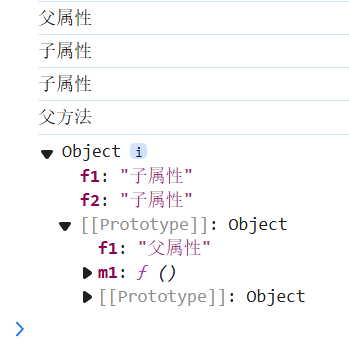

* father 是父对象，son 去调用 m1 方法或 f1 时，自身对象没有，就到父对象找
* son 自己可以添加自己的属性和方法
* son 里有特殊属性 `__proto__` 代表它的父对象，JS 术语：son 的原型对象
* 不同浏览器打印 son 的 `__proto__` 属性时显示不同
  * Edge 打印 `console.dir(son)` 显示 `[[Prototype]]`
  * Firefox 打印 `console.dir(son)` 显示 `<prototype>`

#### 特色：基于函数的原型继承

出于方便的原因，JS 又提供了一种基于函数的原型继承

> **函数职责**：
>
> 1. 负责创建子对象，给子对象提供属性、方法，功能上相当于构造方法
>
> 3. 函数有个特殊的属性 prototype，它就是函数创建的子对象的父对象
>
>    **注意！**名字有差异，这个属性的作用就是为新对象提供原型

```js
function cons(f2) {
    // 创建子对象(this), 给子对象提供属性和方法
    this.f2 = f2;
    this.m2 = function() {
        console.log("子方法");
    }
}

// cons.prototype 就是父对象
cons.prototype.f1 = "父属性";
cons.prototype.m1 = function() {
    console.log("父方法");
}
```

配合 new 关键字，创建子对象

```js
let son = new cons("子属性")
console.log(son.f2) // 子属性
son.m2() // 子方法
console.log(son.f1) // 父属性
son.m1() // 父方法
console.dir(son)
```

子对象的 `__proto__` 就是函数的 `prototype` 属性

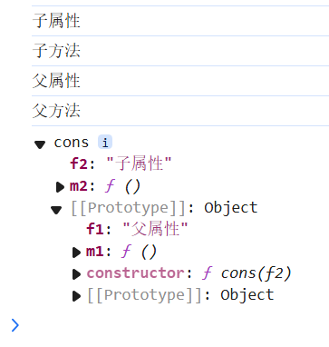

#### JSON

之前我们讲 HTTP 请求格式时，讲过 JSON 这种数据格式，它的语法看起来与 JS 对象非常相似，例如：

一个 JSON 对象可以长这样：

```json
{
    "name": "张三",
    "age": 18
}
```

一个 JS 对象长这样：

```js
{
    name: "张三",
    age: 18
}
```

那么他们的区别在哪儿呢？我总结了这么几点

1. 本质不同
   * JSON 对象本质上是个字符串，它的职责是作为客户端和服务器之间传递数据的一种格式。它的属性只是样子货，在 JSON 字符串转换成对象之前，字符串中的属性是读取不出来的
   * JS 对象是切切实实的对象，可以有属性方法
2. 语法细节不同
   * JSON 中只能有 null、true / false、数字、字符串（只有双引号）、对象、数组
   * JSON 中不能有除以上的其它 JS 对象的特性，如方法等
   * JSON 中的属性必须用双引号引起来

JSON 字符串与 JS 对象的转换：

```js
JSON.parse(JSON字符串);  // 返回JS对象
JSON.stringify(JS对象);  // 返回JSON字符串
```

代码示例：

```js
let json = `{
    "name": "张三",
    "age": 18
}`
console.log(json)
console.dir(json)
console.log(json.name) // undefined
console.log(json.age) // undefined

let obj = {
    name: "张三",
    age: 18,
}
console.log(obj)
console.dir(obj)
console.log(obj.name)
console.log(obj.age)

let obj2 = JSON.parse(json)
console.log(obj2)
console.dir(obj2)
console.log(obj2.name)
console.log(obj2.age)

let str = JSON.stringify(obj)
console.log(str)
```

## 4、动态类型

静态类型语言，如 Java，值有类型，变量也有类型，赋值给变量时类型要相符

```java
int a = 10;
String b = "abc";

int c = "abc";  // 错误
```

而 JavaScript 属于动态类型语言，值有类型，但变量没有类型，赋值给变量时没要求

例如：

```js
let a = 200;

let b = 100;
b = 'abc';
b = true;
```

动态类型看起来比较灵活，但变量没有类型，会给后期维护带来困难，例如：

```js
function test(obj) {
    // obj 的类型未知，必须根据不同类型做出相应的容错处理
}
```

# 二、运算符与表达式

一些简单的运算符如下所示，和 Java 中的没有什么区别，就不详细讲解了，只是注意一下 `**` 是乘方运算符即可

* `+ - * / % **(乘方)`
* `+= -= *= /= %= **=`
* `++ --`
* 位运算、移位运算
* `== != > >= < <=`

**重点关注下面的这些运算符**！

* `=== !==`
* `&& || !`
* `?? ?.`
* `...`
* 解构赋值

## 1、\=== 与 !==

严格相等运算符 ===，用作逻辑判等

```js
1 == 1    	// 返回 true 
1 == '1'	// 返回 true，会先将右侧的字符串转为数字，再做比较
1 === '1'	// 返回 false，类型不等，直接返回 false
```

严格不等运算符 !==，用法刚好与严格相等相反

```js
console.log(1 != 1) // false
console.log(1 != '1') // false
console.log(1 !== '1') // true
```

`typeof` 查看某个值的类型

```js
console.log(typeof 1) // number
console.log(typeof '1') // string
console.log(typeof true) // boolean
console.log(typeof {}) // object
console.log(typeof []) // object
console.log(typeof null) // object
console.log(typeof undefined) // undefined
console.log(typeof NaN) // number
console.log(typeof function () {}) // function
```

## 2、逻辑或 ||

需求：如果参数 n 没有传递，给它赋值 '男'

**推荐**做法

```js
function test(n = '男') {
    console.log(n);
}
```

别人可能的做法

```js
function test(n) {
    if(n === undefined) {
        n = '男';
    }
    console.log(n);
}
```

还可能是这样

```js
function test(n) {
    n = (n === undefined) ? '男' : n;
    console.log(n);
}
```

一些老旧代码中可能的做法（不推荐）

```js
function test(n) {
    n = n || '男';
    console.log(n);
}
```

它的语法是：`值1 || 值2`

如果值 1 是 Truthy，返回值 1；如果值 1 是 Falsy 返回值 2

> 下面的值都是 Falsy：
>
> * false
> * Nullish（null、undefined）
> * 0、0n、NaN
> * ""、''、``，及长度为零的字符串

## 3、?? 与 ?.

### 3.1、空值合并运算符 ??

需求：如果参数 n 没有传递或是 null，给它赋值 '男'

如果用传统办法

```js
function test(n) {
    if(n === undefined || n === null) {
        n = '男';
    }
    console.log(n);
}
```

可以用 `??` 实现相同效果：

```js
function test(n) {
    n = n ?? '男';
    console.log(n);
}
```

语法：`值1 ?? 值2`

* 值 1 是 nullish，返回值 2
* 值 1 不是 nullish，返回值 1

### 3.2、可选链运算符 ?.

需求：函数参数是一个对象，可能包含有子属性，现在要访问子属性

例如，参数可能是

```js
let stu1 = {
    name: "张三",
    address: {
        city: '北京'
    }
};

let stu2 = {
    name: "李四"
}

let stu3 = {
    name: "李四",
    address: null
}
```

一种有问题的写法：

```js
function test(stu) {
    console.log(stu.address.city)
}

test(stu1)
test(stu2) // 报错，stu2没有子属性city
test(stu3) // 报错，stu3的子属性city为null
```

现在希望当某个属性是 nullish 时，短路并返回 undefined，可以用可选链运算符 `?.`

```js
function test(stu) {
    console.log(stu.address?.city)
}
```

用传统办法则显得很啰嗦

```js
function test(stu) {
    if (stu.address === undefined || stu.address === null) {
        console.log(undefined);
        return;
    }
    console.log(stu.address.city)
}
```

## 4、展开运算符 ...

1、作用 1：打散数组，把元素传递给多个参数

```js
let arr = [1, 2, 3];

function test(a, b, c) {
    console.log(a, b, c);
}
```

需求：把数组元素依次传递给函数参数

传统写法

```js
test(arr[0], arr[1], arr[2]); // 输出 1,2,3
```

展开运算符写法

```js
test(...arr); // 输出 1,2,3
```

* 打散可以理解为【去掉了】数组外侧的中括号，只剩下数组元素

2、作用 2：复制数组或对象

复制数组：

```js
let arr1 = [1, 2, 3];
let arr2 = [...arr1]; // 复制数组
```

复制对象：

```js
let obj1 = {name: '张三', age: 18};

let obj2 = {...obj1}; // 复制对象

let obj3 = {
    ...obj1,
    address: '北京'
}
```

**注意**：展开运算符复制属于浅拷贝，例如

```js
let o1 = {name: '张三', address: {city: '北京'}}
let o2 = {...o1};

o1.address.city = '成都'
console.log(o1)
console.log(o2) // o2的city跟着变成‘成都’
```

3、作用 3：合并数组或对象

合并数组

```js
let a1 = [1, 2];
let a2 = [3, 4];

let b1 = [...a1, ...a2];    // 结果 [1,2,3,4]
let b2 = [...a2, 5, ...a1]    // 结果 [3,4,5,1,2]
```

合并对象

```js
let o1 = {name: '张三'};
let o2 = {age: 18};
let o3 = {name: '李四'};

let n1 = {...o1, ...o2}; // 结果 {name: '张三', age: 18}
let n2 = {...o1, ...o2, ...o3}; // 结果 {name: '李四', age: 18}
```

* 复制对象时出现同名属性，后面的会覆盖前面的

## 5、解构赋值运算符 [] 和 {}

### 5.1、[]

`[]` 用于数组的解构赋值

用在声明变量时

```js
let arr = [1, 2, 3];

let [a, b, c] = arr; // 结果 a=1, b=2, c=3
```

用在声明参数时

```js
let arr = [1, 2, 3];

function test([a, b, c]) {
    console.log(a, b, c) // 结果 a=1, b=2, c=3
}

test(arr);
```

### 5.2、{}

`{}` 用于对象的解构赋值

用在声明变量时

```js
let obj = {name: "张三", age: 18}

// 变量名称需要和对象属性名字一致
let {name, age} = obj // 结果 name=张三, age=18
```

用在声明参数时

```js
let obj = {name: "张三", age: 18};

function test({name, age}) {
    console.log(name, age); // 结果 name=张三, age=18
}

test(obj)
```

# 三、控制语句

一些跟 Java 中一样的控制语句就不详细介绍了：

* `if ... else`
* `switch`
* `while`
* `do ... while`
* `for`

**重点关注下面这几个和 Java 不一样的**：

* `for ... in`
* `for ... of`
* `try ... catch`

## 1、for in

主要用来遍历对象

```js
let father = {name:'张三', age:18, study:function(){}};

for (const n in father) {
    console.log(n);
}
```

* 其中 const n 代表遍历出来的属性名
* 注意 1：方法名也能被遍历出来（它其实也算一种特殊属性）
* 注意 2：遍历子对象时，父对象的属性会跟着遍历出来

```js
let son = Object.create(father);
son.sex = "男";

for(const n in son) {
    console.log(n);
}
```

* 注意 3：在 for in 内获取属性值，要使用 `[]` 语法，而不能用 `.` 语法

```js
for (const n in son) {
    console.log(n); // name, age, study, sex
    console.log(son.n) // undefined
    console.log(son[n]) // 张三, 18, ƒ () { }, 男
}
```

## 2、for of

主要用来遍历数组，也可以是其它可迭代对象，如 Map、Set 等

```js
let a1 = [1, 2, 3]

for (const i of a1) {
    console.log(i);
}

let a2 = [
    { name: '张三', age: 18 },
    { name: '李四', age: 20 },
    { name: '王五', age: 22 }
]

for (const obj of a2) {
    console.log(obj.name, obj.age)
}

// 使用{}解构赋值运算符配合for循环
for (const {name, age} of a2) {
    console.log(name, age)
}
```

## 3、try catch

```js
let stu1 = {name: '张三', age: 18, address: {city: '北京'}};
let stu2 = {name: '张三', age: 18};

function test(stu) {
    try {
        console.log(stu.address.city)   
    } catch (e) {
        console.log('出现了异常', e.message)
    } finally {
        console.log('finally');
    }
}

test(stu1)
test(stu2) // 出现了异常：Cannot read properties of undefined (reading 'city')
```

# 四、API

## 1、环境准备

### 1.1、安装 nvm

nvm 即 node version manager，好处是方便切换 Node.js 版本

nvm 下载地址：<https://github.com/nvm-windows/nvm/releases>

安装注意事项：

1. 要卸载掉现有的 Node.js
2. 提示选择 nvm 和 Node.js 目录时，一定要避免目录中出现空格
3. 选用【以管理员身份运行】cmd 程序来执行 nvm 命令
4. 首次运行前设置好国内镜像地址

```shell
# 已过时
# nvm node_mirror http://npm.taobao.org/mirrors/node/
# nvm npm_mirror https://npm.taobao.org/mirrors/npm/

nvm node_mirror https://npmmirror.com/mirrors/node/
nvm npm_mirror https://npmmirror.com/mirrors/npm/
```

> 注意：原域名 <https://registry.npm.taobao.org/> 在 2022.06.30 号正式下线和停止 DNS 解析，新域名为 <https://registry.npmmirror.com>

首先查看有哪些可用版本

```shell
nvm list available
```

输出：

```

|   CURRENT    |     LTS      |  OLD STABLE  | OLD UNSTABLE |
|--------------|--------------|--------------|--------------|
|    18.7.0    |   16.16.0    |   0.12.18    |   0.11.16    |
|    18.6.0    |   16.15.1    |   0.12.17    |   0.11.15    |
|    18.5.0    |   16.15.0    |   0.12.16    |   0.11.14    |
|    18.4.0    |   16.14.2    |   0.12.15    |   0.11.13    |
|    18.3.0    |   16.14.1    |   0.12.14    |   0.11.12    |
|    18.2.0    |   16.14.0    |   0.12.13    |   0.11.11    |
|    18.1.0    |   16.13.2    |   0.12.12    |   0.11.10    |
|    18.0.0    |   16.13.1    |   0.12.11    |    0.11.9    |
|    17.9.1    |   16.13.0    |   0.12.10    |    0.11.8    |
|    17.9.0    |   14.20.0    |    0.12.9    |    0.11.7    |
|    17.8.0    |   14.19.3    |    0.12.8    |    0.11.6    |
|    17.7.2    |   14.19.2    |    0.12.7    |    0.11.5    |
|    17.7.1    |   14.19.1    |    0.12.6    |    0.11.4    |
|    17.7.0    |   14.19.0    |    0.12.5    |    0.11.3    |
|    17.6.0    |   14.18.3    |    0.12.4    |    0.11.2    |
|    17.5.0    |   14.18.2    |    0.12.3    |    0.11.1    |
|    17.4.0    |   14.18.1    |    0.12.2    |    0.11.0    |
|    17.3.1    |   14.18.0    |    0.12.1    |    0.9.12    |
|    17.3.0    |   14.17.6    |    0.12.0    |    0.9.11    |
|    17.2.0    |   14.17.5    |   0.10.48    |    0.9.10    |
```

建议安装 LTS（长期支持版）

```shell
nvm install 16.16.0
nvm install 14.20.0
```

执行 `nvm list` 会列出已安装版本

切换到 16.16.0

```shell
nvm use 16.16.0
```

切换到 14.20.0

```shell
nvm use 14.20.0
```

安装后 nvm 自己的环境变量会自动添加，但可能需要手工添加 Node.js 的 PATH 环境变量

### 1.2、检查 npm

npm 是 JS 的包管理器，就类似于 Java 里的 Maven，要确保它使用的是国内镜像

检查镜像：

```shell
npm get registry
```

如果返回的不是 `https://registry.npmmirror.com/`，需要做如下设置

```shell
npm config set registry https://npmmirror.com/
```

### 1.3、搭建前端服务器

新建一个保存项目的 client 文件夹，进入文件夹执行

```shell
npm install express --save-dev
```

为了能使用 import，先修改 package.json 文件

```json
{
  "type": "module",
  "devDependencies": {
    "express": "^4.18.1"
  }
}
```

* 其中 devDependencies 是 `npm install --save-dev` 添加的

编写 main.js 代码

```js
import express from 'express'
const app = express()

// 设置当前目录为静态资源目录
app.use(express.static('./'))
app.listen(7070)
```

新建一个静态资源 index.html

```html
<!DOCTYPE html>
<html lang="en">

<head>
    <meta charset="UTF-8">
    <meta name="viewport" content="width=device-width, initial-scale=1.0">
    <title>首页</title>
</head>

<body>
    <h1>Hello World</h1>
</body>

</html>
```

使用快捷键 Ctrl + Shift + ` 打开 VSCode 集成终端，执行 JS 代码（运行前端服务器）

```shell
node main.js
```

打开浏览器访问 localhost:7070 即可访问到 index.html 页面

## 2、前端案例

初步效果：

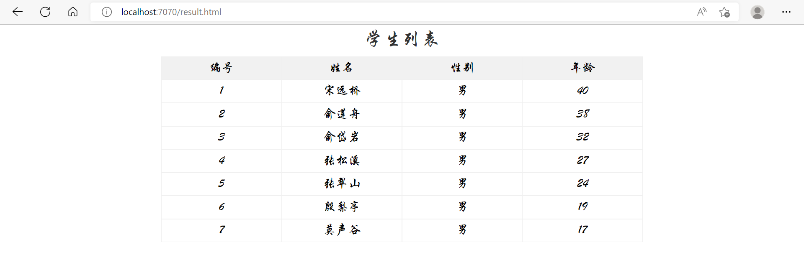

系统架构：

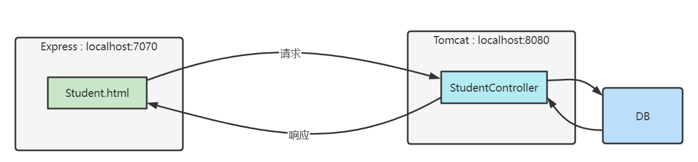

* 前端只有静态页面，使用 Express 服务器
* 后端使用 Tomcat 服务器，通过 Spring Boot、MyBatis 等框架获取数据库数据

### 2.1、查找元素

* `document.getElementById()`：根据 id 值查找一个元素
* `[document / 元素].querySelector()`：根据选择器查找第一个匹配元素
* `[document / 元素].querySelectorAll()`：根据选择器查找所有匹配元素

例如，有下面的 html 代码

```html
<div>
    <div class="title">学生列表</div>
    <div class="thead">
        <div class="row bold">
            <div class="col">编号</div>
            <div class="col">姓名</div>
            <div class="col">性别</div>
            <div class="col">年龄</div>
        </div>
    </div>
    <div class="tbody">
        <div class="row">
            <div class="col">1</div>
            <div class="col">张三</div>
            <div class="col">男</div>
            <div class="col">18</div>
        </div>
    </div>
</div>
```

执行

```js
document.querySelector('.title'); // 找到 <div class="title">学生列表</div>
```

执行

```js
document.querySelector('.col'); // 找到 <div class="col">编号</div>
```

执行

```js
document.querySelectorAll('.col');

/*
  找到的是一个集合
  <div class="col">编号</div>
  <div class="col">姓名</div>
  <div class="col">性别</div>
  <div class="col">年龄</div>
  <div class="col">1</div>
  <div class="col">张三</div>
  <div class="col">男</div>
  <div class="col">18</div>
*/
```

执行

```js
const thead = document.querySelector('.thead');

// 只在 thead 元素范围内找
thead.querySelectorAll('.col');

/*
  找到的是一个集合
  <div class="col">编号</div>
  <div class="col">姓名</div>
  <div class="col">性别</div>
  <div class="col">年龄</div>
*/
```

根据 id 属性查找既可以用如下方式

```js
document.getElementById("id值")
```

也可以用另一种方式

```js
document.querySelector("#id值")
```

### 2.2、修改元素内容

* `元素.innerHTML`
* `元素.textContent`

代码示例：

```js
document.querySelector('.title').innerHTML = '侠客列表'
document.querySelector('.title').innerText = '学生列表'
document.querySelector('.title').textContent = '侠客列表'
```

效果：

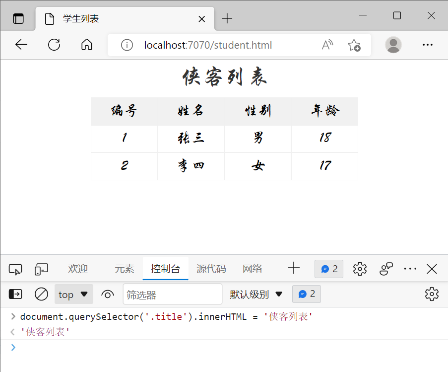

innerHTML  会解析内容中的标签，例如：

```js
// innerHTML 会解析内容中的标签
document.querySelector('.title').innerHTML = `<div class="row bold">
                <div class="col">编号</div>
                <div class="col">姓名</div>
                <div class="col">性别</div>
                <div class="col">年龄</div>
            </div>`
```

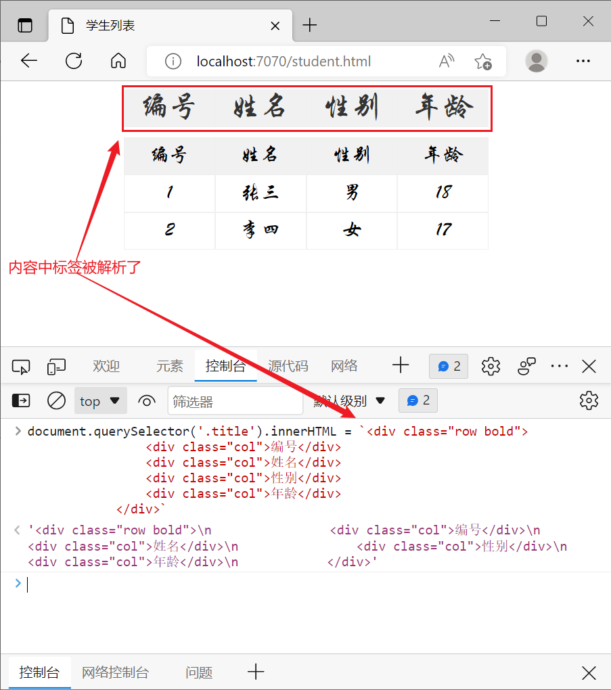

textContext 不会解析内容中的标签

```js
// innerText 不会解析内容中的标签，返回“可见文本”，受 CSS 影响，合并空白符
document.querySelector('.title').innerText = '<span>学生列表</span>'

// textContent 不会解析内容中的标签，返回“所有原始文本”，不受 CSS 影响，保留空白符
document.querySelector('.title').textContent = '<span>侠客列表</span>'
```

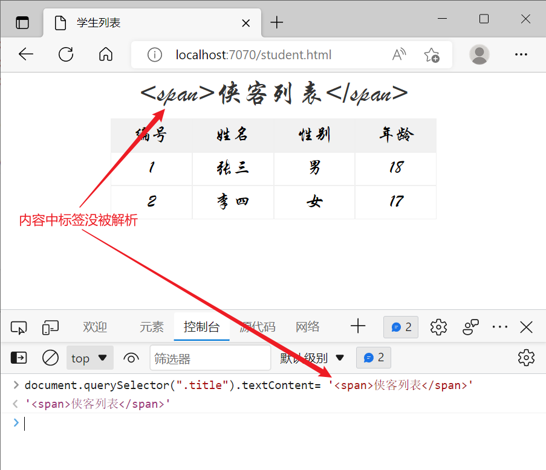

给 innerHTML 或 textContent 赋值空串，可以实现清空标签内容的效果

### 2.3、利用模板

```html
<div>
    <div class="title">学生列表</div>
    <div class="thead">
        <div class="row bold">
            <div class="col">编号</div>
            <div class="col">姓名</div>
            <div class="col">性别</div>
            <div class="col">年龄</div>
        </div>
    </div>
    
    <div class="tbody">
    </div>
</div>

<template id="tp">
    <div class="row">
        <div class="col">xx</div>
        <div class="col">xx</div>
        <div class="col">xx</div>
        <div class="col">xx</div>
    </div>
</template>

<script>
    // 将来这些数据从 Java 端返回
    let array = [
        { id: 1, name: '张三', sex: '男', age: 18 },
        { id: 2, name: '李四', sex: '女', age: 17 }
    ];

    const tbody = document.querySelector('.tbody')
    const tp = document.getElementById("tp")
    const row = tp.content
    const [c1,c2,c3,c4] = row.querySelectorAll(".col")
    
    for(const {id, name, sex, age} of array) {
        c1.textContent = id
        c2.textContent = name
        c3.textContent = sex
        c4.textContent = age
        // 复制元素
        const newRow = document.importNode(row, true);
        // 建立父子关系，左边父，右边子
        tbody.appendChild(newRow);
    }
</script>
```

### 2.4、Fetch API

Java 中同步和异步接收结果：

```java
import com.itheima.util.LoggerUtil;

import java.util.concurrent.CompletableFuture;
import java.util.concurrent.ExecutionException;
import java.util.concurrent.ExecutorService;
import java.util.concurrent.Executors;

/**
 * 同步和异步接受结果
 */
public class TestFuture {
    static ExecutorService pool = Executors.newFixedThreadPool(2);

    public static void main(String[] args) throws ExecutionException, InterruptedException {
        sync();

        async();
    }

    // 异步方式
    private static void async() {
        LoggerUtil.get().debug("之前...");

        CompletableFuture.supplyAsync(() -> {
            LoggerUtil.get().debug("开始计算...");
            sleep2s();
            LoggerUtil.get().debug("结束计算");
            return "123";
        }, pool).thenAcceptAsync(result -> LoggerUtil.get().debug(result), pool);

        LoggerUtil.get().debug("之后...");
    }

    // 同步方式
    private static void sync() throws ExecutionException, InterruptedException {
        LoggerUtil.get().debug("之前...");

        String result = CompletableFuture.supplyAsync(() -> {
            LoggerUtil.get().debug("开始计算");
            sleep2s();
            LoggerUtil.get().debug("结束计算");
            return "123";
        }, pool).get();

        LoggerUtil.get().debug(result);
        LoggerUtil.get().debug("之后...");
    }

    private static void sleep2s() {
        try {
            Thread.sleep(2000);
        } catch (InterruptedException e) {
            throw new RuntimeException(e);
        }
    }
}
```

JavaScript 中的 Fetch API 可以用来获取远程数据，

格式：

```js
fetch(url, options) // 返回 Promise 对象
```

它有两种方式接收结果：同步方式与异步方式

#### 同步方式

```js
const 结果 = await Promise
// 后续代码
```

* await 关键字必须在一个标记了 async 的 function 内来使用
* 后续代码不会在结果返回前执行

代码示例：

在 express 服务器上有个 students.json 文件

```json
[
    { "id": 1, "name": "张三", "sex": "男", "age": 18 },
    { "id": 2, "name": "李四", "sex": "女", "age": 17 }
]
```

现在用 Fetch API 获取这些数据，并展示

同步方式：

```javascript
async function findStudents() {
    try {
        // 获取响应对象
        const resp = await fetch('students.json')

        // 获取响应体, 按JSON格式转换为JS数组
        const array = await resp.json();

        // 显示数据
        const tp = document.getElementById("tp");
        const row = tp.content;
        const [c1, c2, c3, c4] = row.querySelectorAll(".col");
        const tbody = document.querySelector('.tbody');
        for(const {id, name, sex, age} of array) {
            c1.textContent = id;
            c2.textContent = name;
            c3.textContent = sex;
            c4.textContent = age;
            // 复制元素
            const newRow = document.importNode(row, true);
            // 建立父子关系
            tbody.appendChild(newRow);
        }
    } catch (e) {
        console.log(e);
    }
}

findStudents()
```

* `fetch('students.json')` 内部会发送请求，但响应结果不能立刻返回，因此 await 就是等待响应结果返回
* 其中 `resp.json()` 也不是立刻能返回结果，它返回的也是 Promise 对象，也要配合 await 取结果

#### 异步方式

```js
Promise.then(结果 => { ... })
// 后续代码
```

* 后续代码不必等待结果返回就可以执行

代码示例：

用异步方式获取 students.json 文件中的数据并展示

```html
<script>
    fetch('students.json')
        .then(resp => resp.json())
        .then(array => {
        	// 显示数据
            const tp = document.getElementById("tp");
            const row = tp.content;
            const [c1, c2, c3, c4] = row.querySelectorAll(".col");
            const tbody = document.querySelector('.tbody');
            for (const {id, name, sex, age} of array) {
                c1.textContent = id;
                c2.textContent = name;
                c3.textContent = sex;
                c4.textContent = age;
                // 复制元素
                const newRow = document.importNode(row, true);
                // 建立父子关系
                tbody.appendChild(newRow);
            }
        })
        .catch(e => console.log(e))
</script>
```

* 第一个 then 是在响应返回后，才会调用它里面的箭头函数，箭头函数参数即 resp  响应对象
* 第二个 then 是在 JSON 解析完成后，才会调用它里面的箭头函数，箭头函数参数即解析结果（本例是 array 数组）
* 上一个 then 返回的是 Promise 对象时，才能链式调用下一个 then

#### 跨域问题

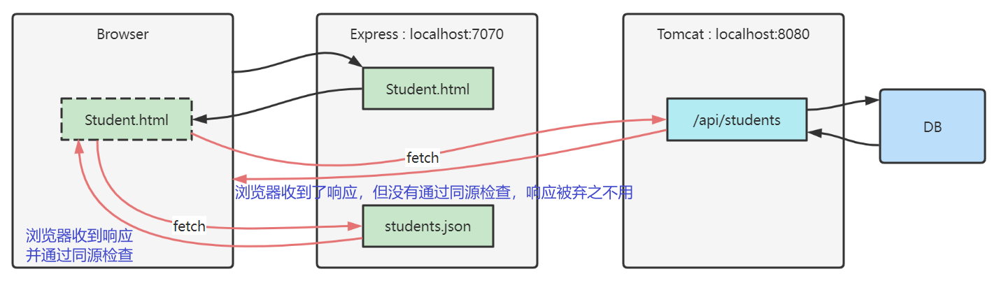

* 只要协议、主机、端口之一不同，就不同源，例如
  * http://localhost:7070/a 和 https://localhost:7070/b 就不同源，因为协议不同
* 同源检查是浏览器的行为，而且只针对 Fetch、xhr 请求
  * 如果是其它客户端，例如 Java http client、Postman，它们是不做同源检查的
  * 通过表单提交、浏览器直接输入 url 地址这些方式发送的请求，也不会做同源检查
* 更多相关知识请参考
  * [跨源资源共享（CORS） - HTTP | MDN (mozilla.org)](https://developer.mozilla.org/zh-CN/docs/Web/HTTP/CORS)

解决跨域问题的两种方法：

1、请求响应头解决

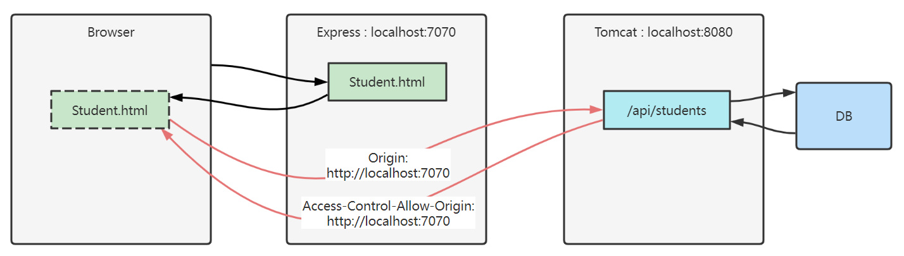

* fetch 请求跨域，会携带一个 Origin 头，代表【发请求的资源源自何处】，目标通过它就能辨别是否发生跨域
  * 我们的例子中：student.html 发送 fetch 请求，告诉 Tomcat，我源自 localhost:7070
* 目标资源通过返回 Access-Control-Allow-Origin 头，告诉浏览器【允许哪些源使用此响应】
  * 我们的例子中：Tomcat 返回 fetch 响应，告诉浏览器，这个响应允许源自 localhost:7070 的资源使用

只需在 Java 代码中添加一个注解 `@CrossOrigin("http://localhost:7070")`

```java
@RestController
public class StudentController {
    @Autowired
    private StudentService studentService;

    @GetMapping("/api/students")
    @CrossOrigin("http://localhost:7070")
    public R all() {
        return R.ok(studentService.findAll());
    }
}
```

2、代理解决

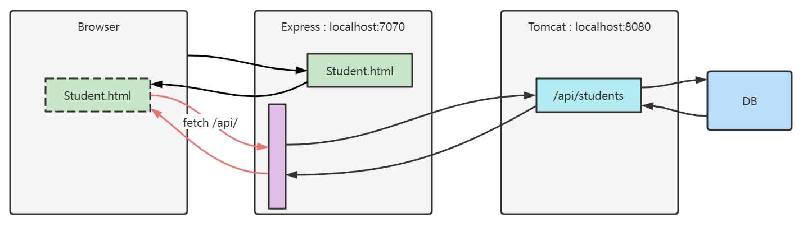

先安装代理插件：

```shell
npm install http-proxy-middleware --save-dev
```

在 express 服务器启动代码中加入

```js
import {createProxyMiddleware} from 'http-proxy-middleware'

// ...

app.use('/api', createProxyMiddleware({ target: 'http://localhost:8080/api', changeOrigin: true }));
```

fetch 代码改为

```js
const resp = await fetch('http://localhost:7070/api/students')
```

或

```js
const resp = await fetch('/api/students')
```

### 2.5、模块化

当项目规模变大时，需要把 JavaScript 代码拆成多个 JS 文件，每个 JS 文件可以称为一个 JS 模块。模块与模块之间相互引用，就需要用到导入和导出的语法。

1、导出语法

（1）单个导出 const、let、function

```js
export const a = 10;
export let b = 20;
export function c() {
    console.log('c');
}
```

（2）一起导出

```js
const a = 10;
let b = 20;
function c() {
    console.log('c')
}

export {a, b, c}
```

（3）导出默认，只能有一个

```js
export const a = 10;
export let b = 20;
export function c() {
    console.log('c')
}

export default b;
```

2、import 语法

```html
<script type="module">
	import 语句
</script>
```

* import 需要遵循同源策略

（1）单个导入

```js
import {a, c} from '/1.js'
console.log(a)				// 输出10
c()							// 输出c
```

* 导入的名字必须和导出的名字一样

（2）导入默认

* 导入的名字可以和默认导出的名字不一样

```js
import x from '/1.js'     // x对应默认导出的b
console.log(x)            // 输出20
```

（3）整个导入

```js
import * as module from '/1.js'
console.log(module)
console.log(module.a)		// 输出10
console.log(module.b)		// 输出20
module.c()					// 输出c
console.log(module.default)
```

